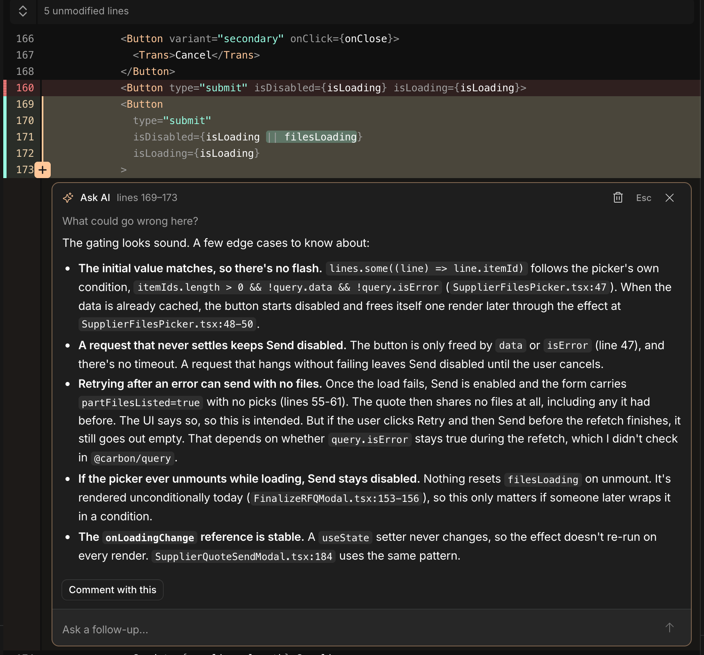
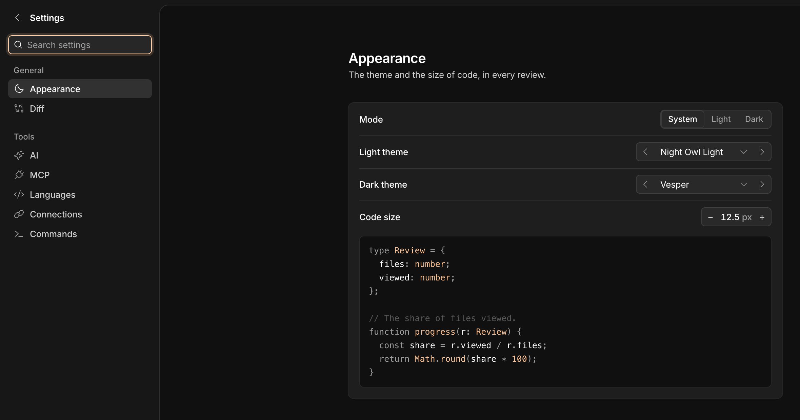

<p align="center"></p>

<h1 align="center">nit</h1>

A keyboard-first code review tool for engineers who read the code. AI helps when you ask.

`nit` opens your branch, or any pull request, in your browser: a fast diff, code navigation that understands the language, search across the whole repository, and the keyboard for everything. You read, comment, and post one review to GitHub. AI is there when you want a second reader, and stays out of the way when you don't.

**[sidwebworks.com/things/nit](https://sidwebworks.com/things/nit)**


- **Local.** One binary on your machine. Your reviews, drafts and keys never leave it.
- **Keyboard first.** Every action has a key, and `⌘K` finds the rest.
- **Assisted, not driven.** AI answers when you ask. It never comments, approves or changes code on its own.

## Install

```sh
curl -fsSL https://raw.githubusercontent.com/sidwebworks/nit/main/install.sh | sh
```

```sh
brew install sidwebworks/tap/nit
```

Both install one binary for macOS or Linux (arm64 and x64; the Linux one runs on any distribution).

## Use

```
nit                 review this branch against its default base
nit <branch>        review against another branch or commit
nit <pr>            review a pull request (number, #number or URL) in its own worktree
nit --attach        the same, and keep the terminal: the server's log, o to open, r to restart
nit stop            stop the server, and every agent and language server it runs
nit logs [-f]       what the server logged; -f keeps following
nit service install start the server at login (nit service uninstall undoes it)
nit mcp             nit's code tools for any agent, over MCP (nit Pro)
nit <command> --help  what a command is for, its options and examples
```

nit opens a tab and gives your terminal back. One server in the background serves all your reviews and stops on its own once none is open. Its own address, `http://nit.localhost:5486`, lists your recent reviews, the comments you haven't posted, the AI work running, and the pull requests waiting for your review. Press `⌘K` for every file and action.

## Code tools for your agent

`nit mcp` is an MCP server on stdin and stdout. Run from a repository, it gives any agent the tools nit's own agent uses, one job each (`review`, `impact`, `diff`, `read`, `symbol`, `search`, `checks`, `source`), every place in their answers written `path:line`: what the change can break (SQL functions included, and a new migration dated before the base's newest), the pull request's failing checks, a dependency's own source at the version the project uses (installed, or cloned once when allowed), the diff by syntax (formatting and moved blocks set aside, the real changes spelled out, and a migration's restated SQL function against the one it replaces), definitions, references, callers, types, a file's outline, and fast search. They only read. The agent can point them at a pull request (checked out in a worktree of its own, never the branch you are on; a worktree that already has its branch is used, and the agent is told what that worktree holds), another branch, or the review you have open in nit. It is part of nit Pro. Add it to an agent the way you add any MCP server, for example:

```
claude mcp add nit -- nit mcp
```

For Claude Desktop or opencode, `nit mcp add claude-desktop` (or `opencode`) writes nit into the app's config. Started outside any repository, the tools follow the review open in nit, and the agent can name a pull request's URL or a repository folder instead.

Then teach the agent when to use them. `nit mcp skill` installs five skills once, in `~/.agents/skills`, where Codex, Cursor, Gemini CLI and opencode read them, and links each into Claude Code's skills, so an update reaches every agent. `nit mcp skill --print` prints them for any other agent, and the server offers them as MCP prompts to any agent that adds it.

- `nit-review-pr` reviews a pull request end to end, in order: point the tools at it, what it can break and its checks, the syntax diff file by file (SQL migrations first), the callers of what changed, the description against the diff, then its structure, with the agent's own skills that fit the change. It reports in one fixed shape: a verdict, findings, where the description disagrees, and what was checked.
- `nit-what-breaks` reads what a change can break: which rows to trust, how to settle a by-name row with `symbol`, what a SQL function's by-string uses are, and the callers a changed body can break without a changed signature.
- `nit-ci-to-diff` matches failing checks to the lines the change touches, and says which failures are unrelated.
- `nit-library-source` checks a claim about a dependency against its own source, with the `source` tool.
- `nit-pr-body` gathers a pull request body's facts (the real changes, what they can break, what CI says, risky migrations) and writes them in the format of your own `pr` skill if you have one.

Each says what agents got wrong reviewing with nit, and the longer ones carry worked examples of the tools' answers in files beside them, read when needed.

```
nit mcp skill
```

## Community and Pro

Everything you do in nit yourself is free. What an agent does is nit Pro: the AI features (co-review, questions about lines, the reading guide, applying comments) and `nit mcp`, nit's code tools for your own agent. How to get a key is at [sidwebworks.com/things/nit](https://sidwebworks.com/things/nit).

**What nit sends, and to whom.** nit makes two kinds of network call on its own, and no telemetry: the check for a newer release on GitHub, every hour while its server runs, and, once you have a key, a daily check with Dodo Payments that the key is still valid. That check sends the key, this device's activation id and "nit on macOS" (or Linux), nothing about you, your machine or your code. Without a key, nit never calls Dodo. Three happen only when you or your agent ask: ⌘-click on a dependency or a bare import opens the package's card, and nit asks that package's registry (npm, crates.io, Go's module proxy or PyPI) about it by name, nothing else, keeping the answer in your browser for a day; installing a checkout's packages runs its package manager, which fetches them from its registry; and when an agent asks for a dependency's source that isn't installed, nit clones that package's repository from GitHub, GitLab or Bitbucket at its version, once, into its own folder (off in Settings → MCP).

## What it does

**Go to definition, without a language server.** nit reads the code with tree-sitter, in the diff and in any file you open: an outline of every file, go to definition, and find references, shown in place under the line, with nothing to install, configure or index. For exact answers, types on hover, type definitions, implementations and callers, turn on a language server you already have for a repository from the bottom of the outline. Every review starts without one. An agent's tools (`nit mcp`, co-review) start the one installed for the files they ask about, for that review only, unless it runs the branch's own build files (Rust, Ruby, C#, Zig); Settings → MCP turns that off. A pull request's worktree reads its packages' types from your main clone's; when it has none, or the pull request changes them, the hover card says so and installs the checkout's own with one click, running none of their install scripts.

<!-- languages: generated by scripts/languages.ts from the conformance grid -->
| Language | nit's own reading | Language server |
|---|---|---|
| C and C++ | supported | clangd |
| C# | supported | csharp-ls |
| Go | supported | gopls |
| Java | supported | jdtls |
| JavaScript | supported | TypeScript's (tsc --lsp) or typescript-language-server |
| PHP | supported | Phpactor (or Intelephense, if installed) |
| Python | supported | basedpyright or pyright |
| Ruby | supported | Solargraph |
| Rust | supported | rust-analyzer |
| TSX | supported | TypeScript's (tsc --lsp) or typescript-language-server |
| TypeScript | supported | TypeScript's (tsc --lsp) or typescript-language-server |
| Zig | supported | zls |

Supported means every case in nit's conformance suite passes: definitions through imports, renamed imports and re-exports, locals that shadow them, methods, what a file exports, and calls reformatted across lines. A language server, once on, answers instead, and also gives types on hover, type definitions, implementations and callers.
<!-- /languages -->


**Search the whole repository.** `⌘⇧F` searches every file, not just the diff, through [fff](https://github.com/dmtrKovalenko/fff)'s native index. Matches show as code, and stay highlighted in the file you open. Regex and case-sensitive search are a key away.


**Merge conflicts, resolved in place.** When the base has moved, nit says which files a merge would conflict in, before you merge. When a merge stops on conflicts, resolve each one side by side: take yours, theirs or both, or type the result. nit stages what you resolve, and the commit stays yours.

**Take a change back.** With the cursor on a change, `⌘⌫` puts the base's lines back in your working tree. A toast undoes it, and nothing is written if the file changed since the diff was read.

**AI, when you ask.** Select lines and press `⌘I`. The AI reads the code around them with the same navigation and search, checks the project's guidelines, and answers under the lines. It can also suggest an order to read the files in, or draft comments you accept or drop. Its review says what it checked and what it thought of how the change is built. It reviews by the same skills `nit mcp skill` gives your own agent, so one improvement to a skill reaches both. Conversations stay on your machine.



**Comments and suggestions, posted as one review.** `c` comments on the selected lines; a suggested change shows as a diff, as on GitHub. Drafts save as you type, and the review posts in one go: Comment, Approve or Request changes.


**Make it yours.** Any Pierre or Shiki theme (one for light, one for dark), code size, layout and wrapping. `o` opens the file at the line in your editor, and pull requests check out with your own command. Settings live in `~/.config/nit/config.toml`; a repository's `.nit.toml` can override them.



**Also:** a reading order AI suggests, setting aside lockfiles, generated code, tests, docs and whitespace-only changes, re-reviewing files that changed since you viewed them, and the pull request's description, checks, CI-flagged lines and linked Linear issue.

## Keyboard

| Keys | Action |
| --- | --- |
| `j` `k` | Next and previous file |
| `n` `p` | Next and previous change |
| `c` | Comment on the selected lines |
| `⌘I` | Ask AI about them |
| `g` `d` | Go to definition |
| `o` | Open in your editor |
| `v` | Mark the file viewed |
| `⌘⌫` | Revert the change under the cursor |
| `⌘/` | Every shortcut, and where to change them |
| `⌘⇧F` | Search the repository |
| `⌘K` | Every file and action |
| `⌘⇧↵` | Review and post |

## What it needs

- **git.** nit reviews the repository you run it in.
- **GitHub**, for pull requests: your `gh` login, or a token saved in Settings (kept in your keychain).
- **AI**, optional: the coding agent you already use, picked in Settings → AI. [Claude Code](https://claude.com/claude-code) (your Claude account or an Anthropic API key) and [Codex](https://github.com/openai/codex) (your ChatGPT account or an OpenAI API key) work as they are. Any other agent that speaks the [Agent Client Protocol](https://agentclientprotocol.com) works by the command that starts it, such as `opencode acp` or `agy acp`; applying comments still uses Claude Code. Everything else works without it.

Reviews, drafts and settings stay on your machine, in `~/.local/share/nit` (or `$NIT_DATA_DIR`). nit itself talks to GitHub, and to the places named under [What nit sends](#community-and-pro); the coding agent you pick talks to its own provider.

## Issues and requests

This repository is where nit's releases are published and where problems and requests are tracked: [open an issue](https://github.com/sidwebworks/nit/issues/new/choose). nit's source is not public from version 1.3.0; the earlier, MIT-licensed prototype (up to 1.2.1) is on the [`prototype`](https://github.com/sidwebworks/nit/tree/prototype) branch.

## Standing on the shoulders of giants

nit exists because of other people's work. It would not be possible without these projects, and a few lines here are the least we owe them.

**Reading code**
- [tree-sitter](https://tree-sitter.github.io) and its grammars: every outline, definition and "what does this change break" answer starts with its syntax trees.
- [ast-grep](https://ast-grep.github.io): searching code by its shape.
- [fff](https://github.com/dmtrKovalenko/fff.nvim): the file and text search that keeps a 100,000-file repository instant.
- [pg_query](https://github.com/pganalyze/pg_query.rs) and [sqlparser](https://github.com/apache/datafusion-sqlparser-rs): reading SQL the way Postgres does.
- The language servers of every language nit supports, and the people who maintain them.

**Diffs and git**
- [Git](https://git-scm.com), of course.
- [gitoxide](https://github.com/GitoxideLabs/gitoxide): reading repositories from Rust.
- [imara-diff](https://github.com/pascalkuthe/imara-diff): fast, readable diffs.
- [odiff](https://github.com/dmtrKovalenko/odiff): nit's pixel diff for images is a port of its comparison.

**The page**
- [Pierre](https://pierre.computer)'s diffs, trees, words and theming: the diff view and the file tree are theirs.
- [React](https://react.dev), [Vite](https://vite.dev), [Tailwind CSS](https://tailwindcss.com) and [TypeScript](https://www.typescriptlang.org).
- [TanStack](https://tanstack.com) Router, Query, Store, Hotkeys and Pacer.
- [Base UI](https://base-ui.com), [Silk](https://silkhq.com) and [Virtuoso](https://virtuoso.dev).
- [Phosphor Icons](https://phosphoricons.com) and the [Inter](https://rsms.me/inter) typeface.
- The [Vesper](https://github.com/raunofreiberg/vesper) and [Night Owl](https://github.com/sdras/night-owl-vscode-theme) themes, nit's defaults.

**The engine**
- [Rust](https://www.rust-lang.org), [Tokio](https://tokio.rs) and [axum](https://github.com/tokio-rs/axum).
- [SQLite](https://sqlite.org) through [rusqlite](https://github.com/rusqlite/rusqlite), and [redb](https://www.redb.org).
- [rmcp](https://github.com/modelcontextprotocol/rust-sdk), the Model Context Protocol's Rust SDK.
- [clap](https://github.com/clap-rs/clap), [serde](https://serde.rs), [rayon](https://github.com/rayon-rs/rayon), [moka](https://github.com/moka-rs/moka) and [keyring](https://github.com/open-source-cooperative/keyring-rs).
- [Zig](https://ziglang.org) and [cargo-zigbuild](https://github.com/rust-cross/cargo-zigbuild), which build nit for every platform from one machine.

## Licence

nit is proprietary software. You may install and use it free of charge, for any work including commercial work; nit Pro's features need a licence key. You may not redistribute or modify it. The terms are in `LICENSE`. Versions up to and including 1.2.1 were released under the MIT licence and stay available under it. The third-party software in nit keeps its own licences: they are in `THIRD-PARTY-NOTICES.txt`, beside nit in every release archive (`nit notices` says where).
