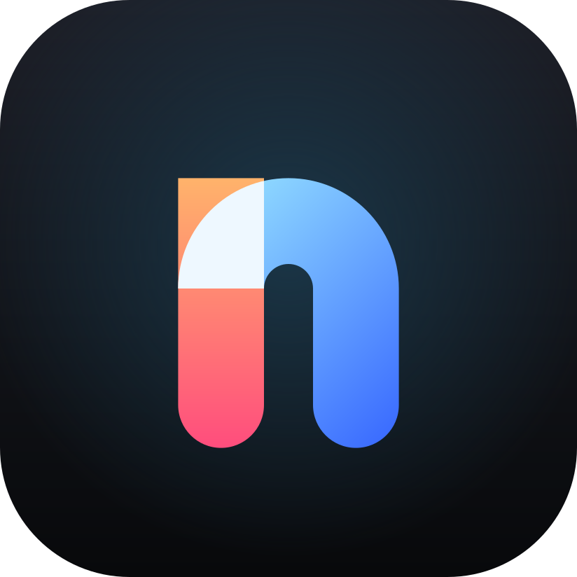
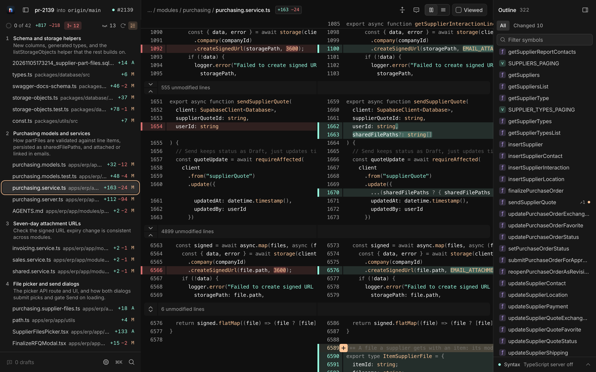
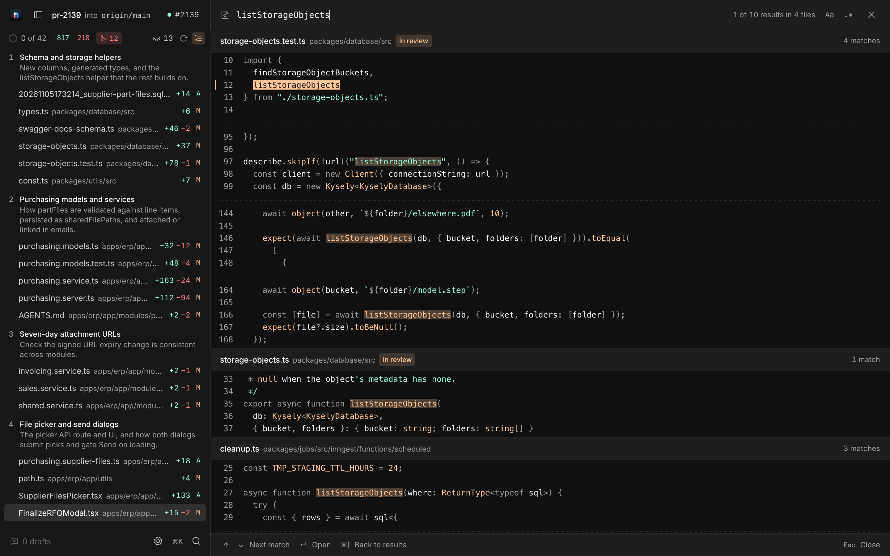

<p align="center"></p>

<h1 align="center">nit</h1>

A keyboard-first code review tool for engineers who read the code. AI helps when you ask.

`nit` opens your branch, or any pull request, in your browser: a fast diff, code navigation that understands the language, search across the whole repository, and the keyboard for everything. You read, comment, and post one review to GitHub. AI is there when you want a second reader, and stays out of the way when you don't.

**[sidwebworks.com/things/nit](https://sidwebworks.com/things/nit)**



- **Local.** One binary on your machine. Your reviews, drafts and keys never leave it.
- **Keyboard first.** Every action has a key, and `⌘K` finds the rest.
- **Assisted, not driven.** AI answers when you ask. It never comments, approves or changes code on its own.

## Install

```sh
curl -fsSL https://raw.githubusercontent.com/sidwebworks/nit/main/install.sh | sh
```

```sh
brew install sidwebworks/tap/nit
```

Both install one binary for macOS or Linux (arm64 and x64; the Linux one runs on any distribution).

## Use

```
nit                 review this branch against its default base
nit <branch>        review against another branch or commit
nit <pr>            review a pull request (number, #number or URL) in its own worktree
nit --attach        the same, and keep the terminal: the server's log, o to open, r to restart
nit stop            stop the server, and every agent and language server it runs
nit logs [-f]       what the server logged; -f keeps following
nit service install start the server at login (nit service uninstall undoes it)
nit mcp             nit's code tools for any agent, over MCP (nit Pro)
nit <command> --help  what a command is for, its options and examples
```

nit opens a tab and gives your terminal back. One server in the background serves all your reviews and stops on its own once none is open. Its own address, `http://nit.localhost:5486`, lists your recent reviews, the comments you haven't posted, the AI work running, and the pull requests waiting for your review. Press `⌘K` for every file and action.

## Code tools for your agent

`nit mcp` is an MCP server on stdin and stdout. Run from a repository, it gives any agent the tools nit's own agent uses, for the branch you're on: what the change can break, a file's diff, the diff by syntax (which hunks are only formatting, which blocks only moved), definitions, references, callers, types, a file's outline, and fast search. They only read. It is part of nit Pro. Add it to an agent the way you add any MCP server, for example:

```
claude mcp add nit -- nit mcp
```

## Community and Pro

Everything you do in nit yourself is free. What an agent does is nit Pro: the AI features (co-review, questions about lines, the reading guide, applying comments) and `nit mcp`, nit's code tools for your own agent. How to get a key is at [sidwebworks.com/things/nit](https://sidwebworks.com/things/nit).

**What nit sends, and to whom.** nit makes two kinds of network call on its own, and no telemetry: the daily check for a newer release on GitHub, and, once you have a key, a daily check with Dodo Payments that the key is still valid. That check sends the key, this device's activation id and "nit on macOS" (or Linux), nothing about you, your machine or your code. Without a key, nit never calls Dodo. Two calls happen only when you ask: ⌘-click on a dependency or a bare import opens the package's card, and nit asks that package's registry (npm, crates.io, Go's module proxy or PyPI) about it by name, nothing else, keeping the answer in your browser for a day; and installing a checkout's packages runs its package manager, which fetches them from its registry.

## What it does

**Go to definition, without a language server.** nit reads the code with tree-sitter, in the diff and in any file you open: an outline of every file, go to definition, and find references, shown in place under the line, with nothing to install, configure or index. For exact answers, types on hover, type definitions, implementations and callers, turn on a language server you already have for a repository from the bottom of the outline. Every review starts without one. A pull request's worktree reads its packages' types from your main clone's; when it has none, or the pull request changes them, the hover card says so and installs the checkout's own with one click, running none of their install scripts.

<!-- languages: generated by scripts/languages.ts from the conformance grid -->
| Language | nit's own reading | Language server |
|---|---|---|
| C and C++ | supported | clangd |
| C# | supported | csharp-ls |
| Go | supported | gopls |
| Java | supported | jdtls |
| JavaScript | supported | TypeScript's (tsc --lsp) or typescript-language-server |
| PHP | supported | Phpactor (or Intelephense, if installed) |
| Python | supported | basedpyright or pyright |
| Ruby | supported | Solargraph |
| Rust | supported | rust-analyzer |
| TSX | supported | TypeScript's (tsc --lsp) or typescript-language-server |
| TypeScript | supported | TypeScript's (tsc --lsp) or typescript-language-server |

Supported means every case in nit's conformance suite passes: definitions through imports, renamed imports and re-exports, locals that shadow them, methods, what a file exports, and calls reformatted across lines. A language server, once on, answers instead, and also gives types on hover, type definitions, implementations and callers.
<!-- /languages -->


**Search the whole repository.** `⌘⇧F` searches every file, not just the diff, through [fff](https://github.com/dmtrKovalenko/fff)'s native index. Matches show as code, and stay highlighted in the file you open. Regex and case-sensitive search are a key away.



**AI, when you ask.** Select lines and press `⌘I`. The AI reads the code around them with the same navigation and search, checks the project's guidelines, and answers under the lines. It can also suggest an order to read the files in, or draft comments you accept or drop. Conversations stay on your machine.


**Comments and suggestions, posted as one review.** `c` comments on the selected lines; a suggested change shows as a diff, as on GitHub. Drafts save as you type, and the review posts in one go: Comment, Approve or Request changes.


**Make it yours.** Any Pierre or Shiki theme (one for light, one for dark), code size, layout and wrapping. `o` opens the file at the line in your editor, and pull requests check out with your own command. Settings live in `~/.config/nit/config.toml`; a repository's `.nit.toml` can override them.


**Also:** a reading order AI suggests, setting aside lockfiles, generated code, tests, docs and whitespace-only changes, re-reviewing files that changed since you viewed them, and the pull request's description, checks, CI-flagged lines and linked Linear issue.

## Keyboard

| Keys | Action |
| --- | --- |
| `j` `k` | Next and previous file |
| `n` `p` | Next and previous change |
| `c` | Comment on the selected lines |
| `⌘I` | Ask AI about them |
| `g` `d` | Go to definition |
| `o` | Open in your editor |
| `v` | Mark the file viewed |
| `⌘⇧F` | Search the repository |
| `⌘K` | Every file and action |
| `⌘⇧↵` | Review and post |

## What it needs

- **git.** nit reviews the repository you run it in.
- **GitHub**, for pull requests: your `gh` login, or a token saved in Settings (kept in your keychain).
- **AI**, optional: the coding agent you already use, picked in Settings → AI. [Claude Code](https://claude.com/claude-code) (your Claude account or an Anthropic API key) and [Codex](https://github.com/openai/codex) (your ChatGPT account or an OpenAI API key) work as they are. Any other agent that speaks the [Agent Client Protocol](https://agentclientprotocol.com) works by the command that starts it, such as `opencode acp` or `agy acp`; applying comments still uses Claude Code. Everything else works without it.

Reviews, drafts and settings stay on your machine, in `~/.local/share/nit` (or `$NIT_DATA_DIR`). nit itself talks to GitHub, and to the places named under [What nit sends](#community-and-pro); the coding agent you pick talks to its own provider.

## Issues and requests

This repository is where nit's releases are published and where problems and requests are tracked: [open an issue](https://github.com/sidwebworks/nit/issues/new/choose). nit's source is not public from version 1.3.0; the earlier, MIT-licensed prototype (up to 1.2.1) is on the [`prototype`](https://github.com/sidwebworks/nit/tree/prototype) branch.

## Licence

nit is proprietary software. You may install and use it free of charge, for any work including commercial work; nit Pro's features need a licence key. You may not redistribute or modify it. The terms are in `LICENSE`. Versions up to and including 1.2.1 were released under the MIT licence and stay available under it. The third-party software in nit keeps its own licences: they are in `THIRD-PARTY-NOTICES.txt`, beside nit in every release archive (`nit notices` says where).
