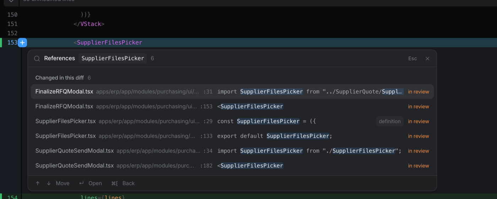
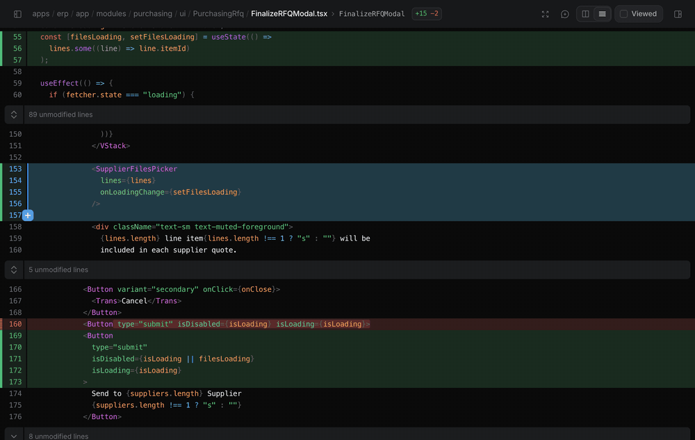
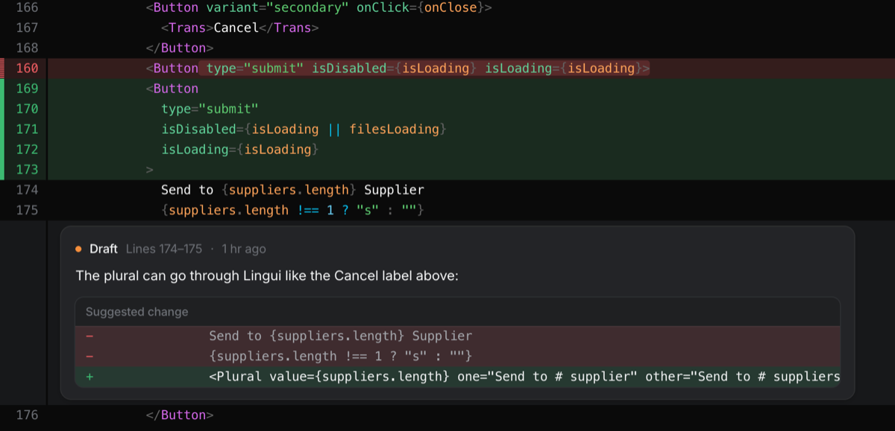

<p align="center"></p>

<h1 align="center">nit</h1>

A keyboard-first code review tool for engineers who read the code. AI helps when you ask.

`nit` opens your branch, or any pull request, in your browser: a fast diff, code navigation that understands the language, search across the whole repository, and the keyboard for everything. You read, comment, and post one review to GitHub. AI is there when you want a second reader, and stays out of the way when you don't.

**[sidwebworks.com/things/nit](https://sidwebworks.com/things/nit)**


- **Local.** One binary on your machine. Your reviews, drafts and keys never leave it.
- **Keyboard first.** Every action has a key, and `⌘K` finds the rest.
- **Assisted, not driven.** AI answers when you ask. It never comments, approves or changes code on its own.

## Install

```sh
curl -fsSL https://raw.githubusercontent.com/sidwebworks/nit/main/install.sh | sh
```

```sh
brew install sidwebworks/tap/nit
```

Both install one binary for macOS or Linux (arm64 and x64).

## Use

```
nit                 review this branch against its default base
nit <branch>        review against another branch or commit
nit <pr>            review a pull request (number, #number or URL) in its own worktree
```

nit starts a local server and opens a tab. Press `⌘K` for every file and action.

## What it does

**Go to definition, without a language server.** nit reads the code with tree-sitter, in the diff and in any file you open: an outline of every file, go to definition, and find references, shown in place under the line. TypeScript, JavaScript, Python, Go, Rust, Java, C#, Ruby, PHP and C++, with nothing to install, configure or index.



**Search the whole repository.** `⌘⇧F` searches every file, not just the diff, through [fff](https://github.com/dmtrKovalenko/fff)'s native index. Matches show as code, and stay highlighted in the file you open. Regex and case-sensitive search are a key away.


**AI, when you ask.** Select lines and press `⌘I`. The AI reads the code around them with the same navigation and search, checks the project's guidelines, and answers under the lines. It can also suggest an order to read the files in, or draft comments you accept or drop. Conversations stay on your machine.



**Comments and suggestions, posted as one review.** `c` comments on the selected lines; a suggested change shows as a diff, as on GitHub. Drafts save as you type, and the review posts in one go: Comment, Approve or Request changes.



**Make it yours.** Any Pierre or Shiki theme (one for light, one for dark), code size, layout and wrapping. `o` opens the file at the line in your editor, and pull requests check out with your own command. Settings live in `~/.config/nit/config.toml`; a repository's `.nit.toml` can override them.


**Also:** a reading order AI suggests, setting aside lockfiles, generated code, tests, docs and whitespace-only changes, re-reviewing files that changed since you viewed them, and the pull request's description, checks, CI-flagged lines and linked Linear issue.

## Keyboard

| Keys | Action |
| --- | --- |
| `j` `k` | Next and previous file |
| `n` `p` | Next and previous change |
| `c` | Comment on the selected lines |
| `⌘I` | Ask AI about them |
| `g` `d` | Go to definition |
| `o` | Open in your editor |
| `v` | Mark the file viewed |
| `⌘⇧F` | Search the repository |
| `⌘K` | Every file and action |
| `⌘⇧↵` | Review and post |

## What it needs

- **git.** nit reviews the repository you run it in.
- **GitHub**, for pull requests: your `gh` login, or a token saved in Settings (kept in your keychain).
- **AI**, optional: [Claude Code](https://claude.com/claude-code) (your Claude account or an Anthropic API key) or [Codex](https://github.com/openai/codex) (your ChatGPT account or an OpenAI API key), picked in Settings → AI. Everything else works without it.

Reviews, drafts and settings stay on your machine, in `~/.local/share/nit` (or `$NIT_DATA_DIR`). nit talks to GitHub and Anthropic, and nothing else.

## Develop

```sh
bun install
bun run dev          # NIT_DEV=1: rebuilds the UI as you edit
bun test
bun run compile      # the single binary for this machine, in dist/release
```

Releases: bump `version` in `package.json`, then push a `v<version>` tag. The release workflow builds every platform, publishes the GitHub release and the Homebrew formula.

## Licence

MIT
